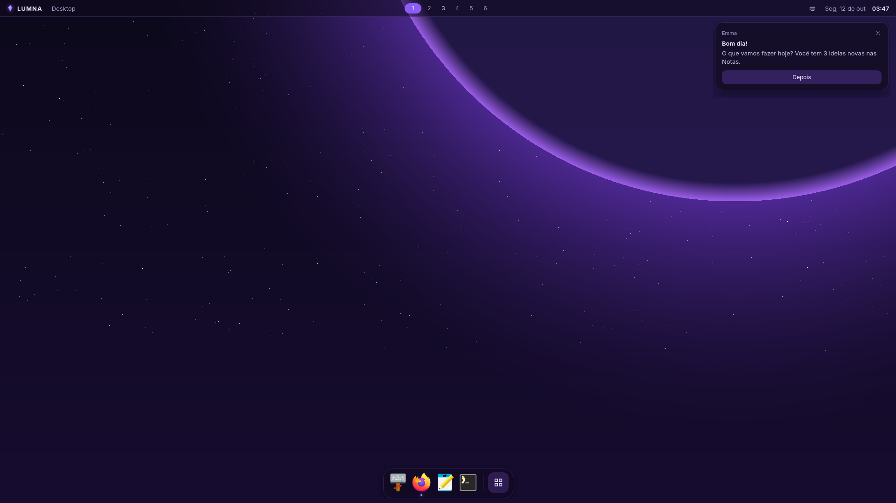
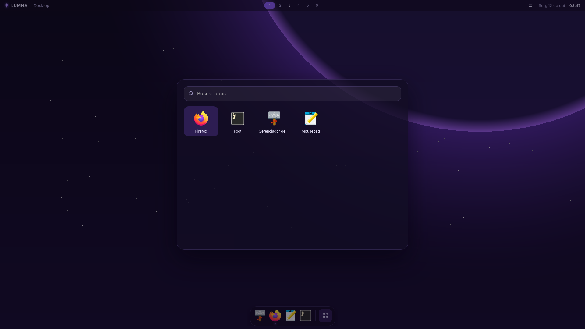
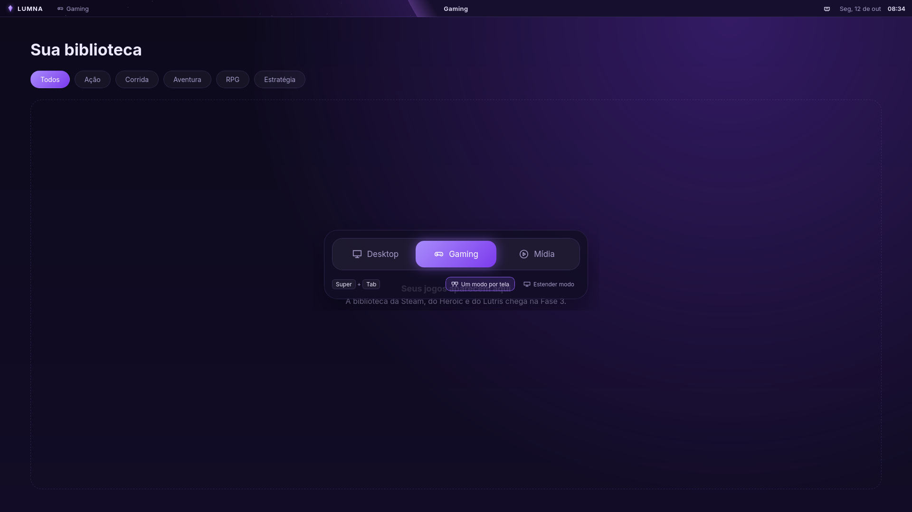
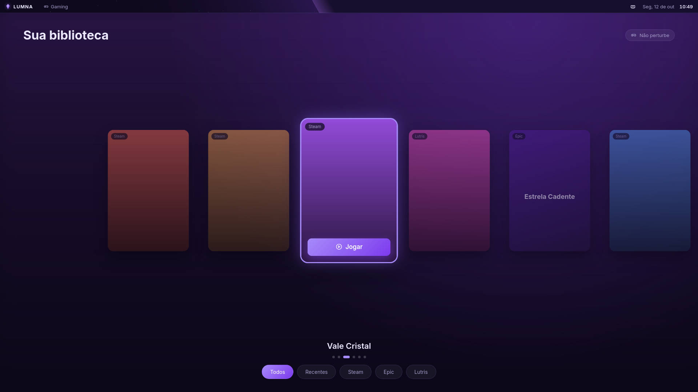
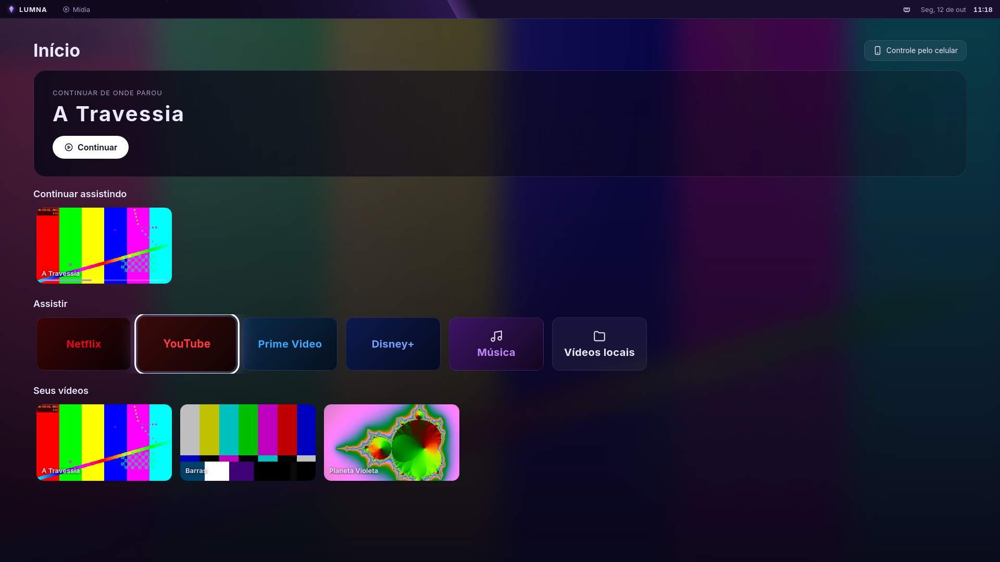

# LUMNA OS

> Seu espaço. Seus modos. Sua Emma.

Distro Linux com três modos (**Desktop**, **Gaming** e **Mídia**) que trocam com `Super + Tab`.
O shell é feito em **Tauri + Vue** e roda sobre o **Hyprland**, com base no **Arch Linux**.
Suporta só GPUs **AMD e Intel**.

- Por que é assim: [docs/VIABILIDADE.md](docs/VIABILIDADE.md)
- Onde estamos: **Fase 4**. O ISO dá boot direto no LUMNA: Desktop (topbar, dock, launcher, avisos), troca de modo, biblioteca de jogos com controle, e a tela de Mídia com controle pelo celular.











## Estrutura

```
crates/lumna-core     tipos e o contrato Compositor (não sabe qual compositor é)
crates/lumna-hypr     Compositor implementado para o Hyprland (IPC por socket)
crates/lumna-ctl      comando que os atalhos usam para falar com o shell
shell/                lumna-shell: app Tauri (src-tauri/) + interface Vue (src/)
session/              config do Hyprland em Lua, script da sessão, entrada do login, wallpaper
packages/             PKGBUILDs dos pacotes lumna-*
iso/                  perfil do ISO (releng do archiso + overlay do LUMNA) e ambiente de build
remote/android/        LUMNA Controle: app Android de controle remoto (Kotlin)
scripts/              build-iso.sh, run-vm.sh, make-art.py
```

## Montar o ISO

Em qualquer Linux com Docker:

```
./scripts/build-iso.sh
```

Compila os pacotes `lumna-*`, valida a config do Hyprland e gera `out/lumna-os-AAAA.MM.DD-x86_64.iso`.
O GitHub Actions faz o mesmo a cada push na `main`, e publica o ISO na Release quando sai uma tag `v*`.

## Testar na VM

Num Linux com KVM, QEMU e OVMF:

```
./scripts/run-vm.sh                # 1 monitor
./scripts/run-vm.sh --telas 3      # 3 monitores virtuais
./scripts/run-vm.sh --disco        # com disco virtual (testes de instalação, Fase 7)
```

A VM usa virtio-gpu com OpenGL (virgl). VirtualBox e VMware costumam ir mal com o Hyprland.

## Testar no PC (pendrive)

Grave o ISO com Ventoy, balenaEtcher ou `dd`, desligue o **Secure Boot** e dê boot pelo pendrive.
Ele roda direto do pendrive (modo live) e não mexe no disco.

No live, o usuário é `lumna` com senha `lumna` (a sessão entra sozinha; a senha só serve se ela
cair e aparecer `lumna login:`). O `root` não tem senha: `Ctrl + Alt + F2` e Enter.

## Atalhos

| Atalho | Ação |
|---|---|
| `Super + Tab` | Próximo modo: Desktop → Gaming → Mídia (`Super + Shift + Tab` volta) |
| `Super + Espaço` | Launcher de apps (busca sem acento; setas e Enter; Esc fecha) |
| `Super + Enter` | Terminal |
| `Super + E` | Arquivos (Thunar) |
| `Super + B` | Firefox |
| `Super + Q` | Fechar janela |
| `Super + 1..9` | Ir para a área de trabalho |
| `Super + Shift + 1..9` | Mover janela para a área de trabalho |
| `Super + F` | Tela cheia |
| `Super + Shift + E` | Sair da sessão |

Na topbar: clique no cristal abre o launcher, clique no volume silencia e a roda do mouse ajusta.
Os avisos dos apps (`notify-send`, Firefox...) aparecem no canto superior direito.

## Modos e telas

Cada monitor tem um modo. Trocar de modo não fecha nada: as janelas de cada modo ficam no lugar.
No seletor "Alternar modo" (clique no nome do modo na topbar ou `Super + Tab`):

- **Um modo por tela**: só o monitor em foco troca (ex.: Desktop num, Gaming no outro).
- **Estender modo**: todos os monitores trocam juntos.

Em Gaming e Mídia o dock some e os avisos ficam em "não perturbe" (só os urgentes aparecem).
Pelo terminal: `lumna-ctl mode gaming`, `lumna-ctl mode layout extend`.

## Biblioteca de jogos

O modo Gaming mostra os jogos instalados da **Steam**, do **Heroic** (Epic, GOG, Amazon) e do
**Lutris**, com as capas que essas lojas já guardam no disco. Os jogados por último vêm primeiro.

| Controle | Teclado | Ação |
|---|---|---|
| Direcional / analógico | Setas | Escolher jogo; para baixo vai aos filtros |
| A (Cruz) | Enter | Jogar / aplicar filtro |
| B (Bola) | Esc | Voltar dos filtros |
| Botão central (Guide/PS/Xbox) | `Super + Tab` | Trocar de modo |

Com um jogo ou app em foco, o controle é dele: só o botão central continua com o LUMNA.
Para o teclado, clique na tela do modo. Sem controle à mão: `lumna-ctl pad right`, `lumna-ctl pad accept`.

A Steam ainda não vem no pendrive (o ISO passaria do limite de 2 GB das Releases do GitHub). No
sistema live: habilite o `[multilib]` em `/etc/pacman.conf` e `sudo pacman -Syu steam`.

## Mídia

- **Streaming** (Netflix, YouTube, Prime Video, Disney+, Música) abre no Firefox em tela cheia,
  num perfil só da TV com o DRM ligado. Na primeira vez o Firefox baixa o Widevine sozinho.
- **Seus vídeos** são os da pasta Vídeos. Tocam no mpv, que guarda onde você parou: é daí que vêm
  o destaque e o "Continuar assistindo".

## LUMNA Controle (celular)

App Android em `remote/android`. O GitHub Actions gera o APK (artefato `lumna-controle-apk`).

1. Celular e TV na mesma rede Wi-Fi.
2. Na TV, modo Mídia → **Controle pelo celular**: aparece um código de 6 dígitos.
3. No app, toque na TV (ela aparece sozinha pela rede) e digite o código.

Depois disso o celular entra sozinho. O app tem direcional, OK, voltar, início (fecha o que está
na frente), menu, volume, play/pausa, ±10 s, os três modos e um campo para digitar na TV.
"Esquecer celulares", na mesma tela da TV, desfaz todos os pareamentos.

A TV só aceita conexões da rede local (porta 47800, WebSocket sem TLS) e só de celulares
pareados; o código vale 5 minutos e uma vez só.

## Problemas

O log do shell fica no journal: `journalctl -t lumna-shell`.
