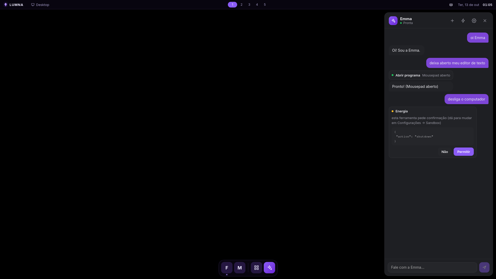
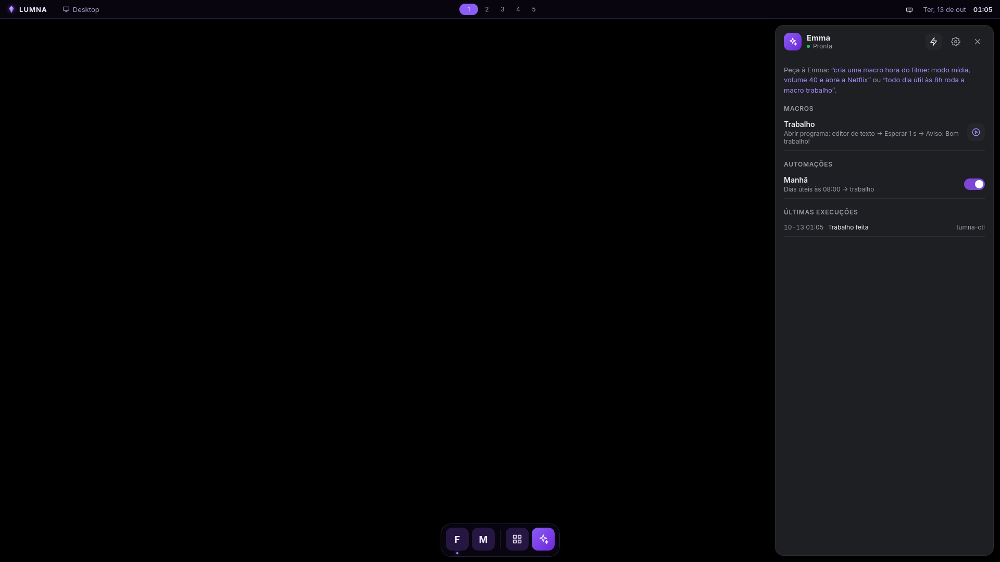
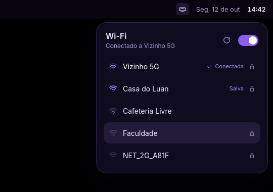
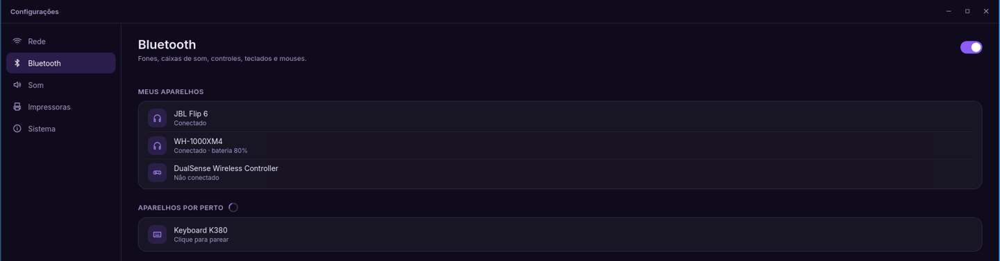
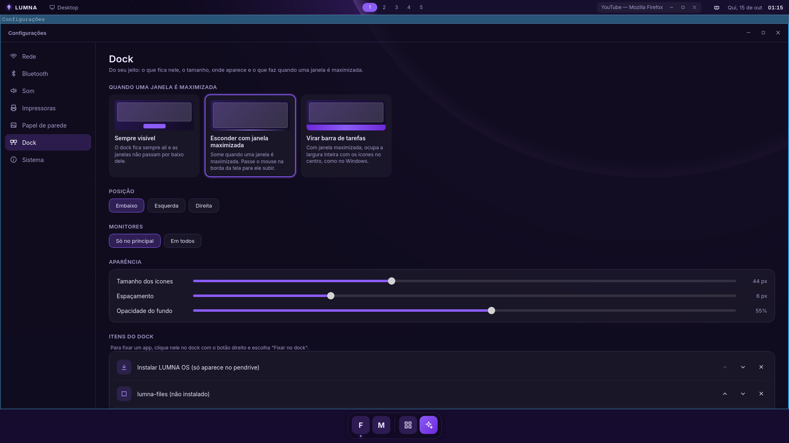
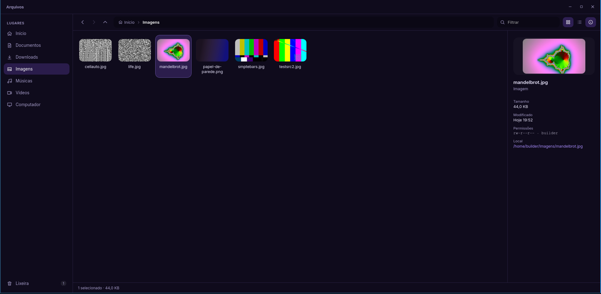
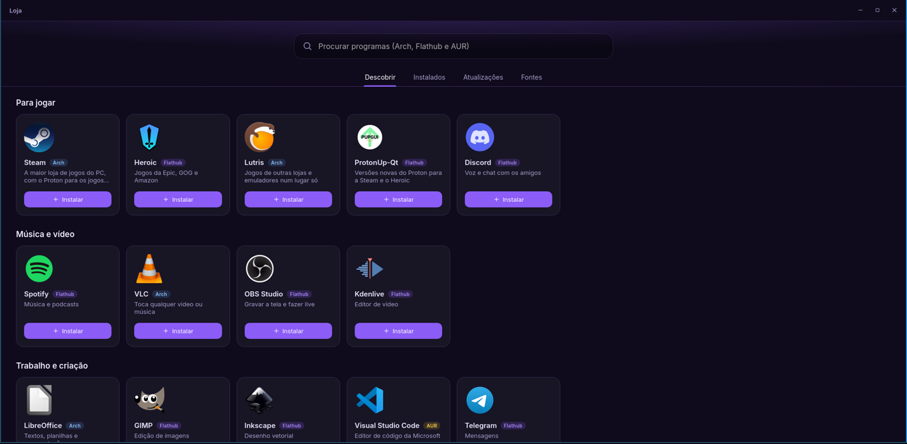
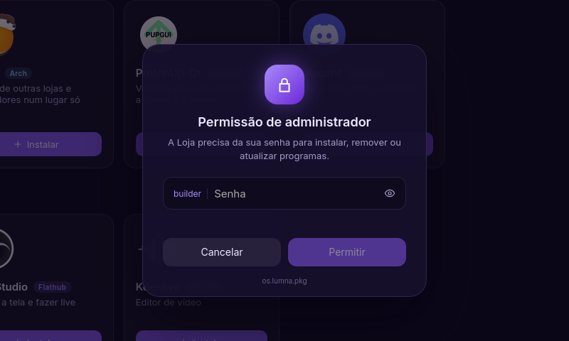

# LUMNA OS

> Seu espaço. Seus modos. Sua Emma.

Distro Linux com três modos (**Desktop**, **Gaming** e **Mídia**) que trocam com `Super + Tab`.
O shell é feito em **Tauri + Vue** e roda sobre o **Hyprland**, com base no **Arch Linux**.
Suporta só GPUs **AMD e Intel**.

- Por que é assim: [docs/VIABILIDADE.md](docs/VIABILIDADE.md)
- Onde estamos: **Fase 4**. O ISO dá boot direto no LUMNA: Desktop (topbar, dock, launcher, avisos), troca de modo, biblioteca de jogos com controle, e a tela de Mídia com controle pelo celular.


## Estrutura

```
crates/lumna-core     tipos e o contrato Compositor (não sabe qual compositor é)
crates/lumna-hypr     Compositor implementado para o Hyprland (IPC por socket)
crates/lumna-ctl      comando que os atalhos usam para falar com o shell
shell/                lumna-shell: app Tauri (src-tauri/) + interface Vue (src/)
                      (inclui as ações e a automação da Emma: actions.rs, automation.rs, emma.rs)
session/              config do Hyprland em Lua, script da sessão, entrada do login, wallpaper
packages/             PKGBUILDs dos pacotes lumna-*
iso/                  perfil do ISO (releng do archiso + overlay do LUMNA) e ambiente de build
remote/android/        LUMNA Controle: app Android de controle remoto (Kotlin)
scripts/              build-iso.sh, run-vm.sh, make-art.py
```

## Montar o ISO

Em qualquer Linux com Docker:

```
./scripts/build-iso.sh
```

Compila os pacotes `lumna-*`, valida a config do Hyprland e gera `out/lumna-os-AAAA.MM.DD-x86_64.iso`.
Com `EMMA_SRC=../NewHarnessV2 ./scripts/build-iso.sh` o ISO já leva o backend da Emma (no GitHub
Actions, pelo segredo `EMMA_REPO_TOKEN`, um token com leitura do NewHarnessV2).
O GitHub Actions faz o mesmo a cada push na `main`, e publica o ISO na Release quando sai uma tag `v*`.

## Testar na VM

Num Linux com KVM, QEMU e OVMF:

```
./scripts/run-vm.sh                # 1 monitor
./scripts/run-vm.sh --telas 3      # 3 monitores virtuais
./scripts/run-vm.sh --disco        # com disco virtual (testes de instalação, Fase 7)
```

A VM usa virtio-gpu com OpenGL (virgl). VirtualBox e VMware costumam ir mal com o Hyprland.

## Testar no PC (pendrive)

Grave o ISO com Ventoy, balenaEtcher ou `dd`, desligue o **Secure Boot** e dê boot pelo pendrive.
Ele roda direto do pendrive (modo live) e não mexe no disco.

No live, o usuário é `lumna` com senha `lumna` (a sessão entra sozinha; a senha só serve se ela
cair e aparecer `lumna login:`). O `root` não tem senha: `Ctrl + Alt + F2` e Enter.

## Atalhos

| Atalho | Ação |
|---|---|
| `Super + Tab` | Próximo modo: Desktop → Gaming → Mídia (`Super + Shift + Tab` volta) |
| `Super + Espaço` | Launcher de apps (busca sem acento; setas e Enter; Esc fecha) |
| `Super + Enter` | Terminal |
| `Super + E` | Arquivos |
| `Super + B` | Firefox |
| `Super + I` | Configurações |
| `Super + L` | Loja |
| `Super + A` | Emma (painel da assistente) |
| `Super + Q` | Fechar janela |
| `Super + 1..9` | Ir para a área de trabalho |
| `Super + Shift + 1..9` | Mover janela para a área de trabalho |
| `Super + F` | Tela cheia |
| `Super + Shift + E` | Menu de energia: sair, suspender, hibernar, reiniciar, desligar |
| `Alt + Shift` | Troca de teclado (com mais de um em Configurações → Teclado e idioma) |

Na topbar: clique no cristal abre o launcher, no ícone de rede abre o menu do Wi-Fi, clique no
volume silencia e a roda do mouse ajusta.
Os avisos dos apps (`notify-send`, Firefox...) aparecem no canto superior direito. O botão no canto
direito abre o menu de energia.

As janelas têm barra de título no visual do LUMNA (título, minimizar, maximizar, fechar; clique duplo
maximiza): é o plugin oficial hyprbars, empacotado como `lumna-hyprbars` e compilado no build do ISO
contra o Hyprland do sistema. Se o Hyprland for atualizado antes de um `lumna-hyprbars` novo, ele só
não carrega o plugin, e a topbar volta a mostrar o título e os botões da janela em foco.

## Emma

A assistente do LUMNA. `Super + A` (ou o botão violeta do dock) abre o painel: peça em português
e ela faz no computador, como *"abre o Spotify"*, *"modo filme"*, *"volume 30"*, *"acha o PDF do
contrato"*, *"fecha o Steam"* ou *"instala o OBS"*.

- **O cérebro** é o backend da Emma (projeto NewHarnessV2), que roda no próprio PC como serviço do
  usuário (pacote `lumna-emma`, `systemctl --user status lumna-emma`). Na primeira vez o painel
  pede o provedor de IA (Ollama Cloud, OpenAI, Gemini, Claude ou um endpoint local, como o Ollama).
- **As mãos** são as ações do LUMNA: abrir qualquer programa instalado (pelo nome aproximado,
  inclusive Flatpak e AUR), janelas, modos, som, mídia, jogos, arquivos, Wi-Fi, Loja, serviços do
  usuário. Lista completa: `lumna-ctl actions`; roda uma na mão:
  `lumna-ctl action apps.open '{"name":"firefox"}'`.
- **Permissões**: no ⚙ do painel, cada ação faz sozinha, pergunta antes ou fica desligada.
  Desligar, instalar e rodar comandos sempre perguntam (e instalar ainda pede a senha).
- **Macros e automações** (⚡ no painel): macro é uma sequência de ações com nome
  (`~/.config/lumna/macros/`); automação roda uma macro sozinha num horário, ao entrar, ao trocar
  de modo, quando um app abre ou fecha, ou quando o Wi-Fi ou um aparelho Bluetooth conecta
  (`~/.config/lumna/automations.json`). Peça à Emma: *"cria uma macro hora do filme: modo mídia,
  volume 40 e abre a Netflix"* e *"roda ela quando eu entrar no modo mídia"*.





Como tudo se liga: [docs/EMMA.md](docs/EMMA.md).

## Wi-Fi

Clique no ícone de rede da topbar. O menu lista as redes por perto (a mais forte primeiro), conecta
nas abertas e nas já salvas com um clique e pede a senha nas novas. Na rede conectada ficam
"Desconectar" e "Esquecer rede"; o botão no topo liga e desliga o Wi-Fi.



Por baixo é o **iwd**, o mesmo do pendrive do Arch: as senhas ficam salvas por ele em
`/var/lib/iwd`. Redes com usuário e senha (empresa, faculdade) ainda não entram pelo menu; no
terminal, `iwctl` resolve.

## Configurações

`Super + I`, o app "Configurações" no launcher ou "Configurações de rede…" no menu do Wi-Fi.

- **Rede**: o Wi-Fi (o mesmo do menu) e os detalhes de cada conexão, cabo ou Wi-Fi: endereço,
  roteador, DNS, velocidade.
- **Bluetooth**: liga e desliga, procura aparelhos enquanto a página está aberta, pareia (confirmando
  o código na tela quando o aparelho pede), conecta, desconecta e esquece. Mostra a bateria dos fones
  e controles. Fora de um pareamento começado aqui, pedidos de outros aparelhos são recusados.
- **Som**: saída e entrada padrão, volume e mudo de cada uma, e o volume de cada app tocando.
- **Impressoras**: procura impressoras na rede e no USB, adiciona sem driver (AirPrint / IPP
  Everywhere), página de teste, impressora padrão e remover.
- **Sistema**: processador, placa de vídeo, memória, disco e versão.
- **Telas**: a ordem dos monitores lado a lado (arraste como estão na sua mesa) e o alinhamento
  na altura — é o que decide por qual borda o mouse passa de uma tela para a outra. Vale na hora e
  nos próximos logins (`~/.config/lumna/monitors.lua`).
- **Teclado e idioma**: um ou mais teclados (qualquer layout e variante do sistema; Alt + Shift
  troca entre eles), aplicados na hora, e o idioma do sistema (vale no próximo login).
- **Energia**: perfil de energia (economia, equilibrado, desempenho) e sair, suspender, hibernar,
  reiniciar e desligar. O menu rápido de energia abre com `Super + Shift + E` ou pelo botão no canto
  da topbar.
- **Papel de parede**: um para todos os desktops; os do LUMNA e as imagens que você adicionar.
- **Dock**: o que fica nele (apps, separadores, "Todos os apps", Emma), tamanho dos ícones,
  espaçamento, opacidade do fundo, posição (embaixo, esquerda, direita), em quais monitores aparece
  e o que faz quando uma janela é maximizada: continua ali, se esconde na borda (volta passando o
  mouse) ou vira uma barra de tarefas de largura inteira com os ícones no centro. Fica em
  `~/.config/lumna/dock.json`; botão direito num app do dock fixa ou desafixa.

Por baixo: iwd (Wi-Fi), BlueZ (Bluetooth), PipeWire (som), CUPS + Avahi (impressoras).





## Arquivos

O explorador de arquivos do LUMNA (`Super + E`, o primeiro ícone do dock, ou qualquer programa que
peça para abrir uma pasta).

- **Lugares** (Início, Documentos, Downloads, Imagens, Músicas, Vídeos, Computador), **Discos**
  (pendrives e outras partições: um clique monta, o botão ao lado ejeta) e a **Lixeira**.
- Grade com miniaturas de fotos e vídeos, ou lista com colunas que ordenam; painel de detalhes
  (tamanho, inclusive de pastas, data, permissões, local).
- Menu próprio no botão direito: abrir, abrir em nova janela, copiar, recortar, colar, renomear,
  copiar caminho, mover para a lixeira, nova pasta, abrir terminal aqui, mostrar ocultos.
- A lixeira é a mesma dos outros programas (padrão freedesktop): restaura para o lugar de origem
  ou apaga de vez.
- A área de transferência vale entre janelas do Arquivos: copie numa, cole na outra.

| Atalho | Ação |
|---|---|
| Enter / clique duplo | Abrir |
| `Backspace`, `Alt + ←` / `Alt + →` | Voltar / avançar |
| `Alt + ↑` | Pasta acima |
| `Ctrl + C` / `X` / `V` | Copiar / recortar / colar |
| `F2` | Renomear |
| `Delete` | Mover para a lixeira |
| `Ctrl + Shift + N` | Nova pasta |
| `Ctrl + L` | Digitar o caminho |
| `Ctrl + F` | Filtrar a pasta |
| `Ctrl + H` | Mostrar ou esconder ocultos |
| `Ctrl + N` | Nova janela |
| Digitar letras | Pula para o arquivo com esse nome |



## Loja

`Super + L` ou o app "Loja" no launcher. Programas de três fontes, numa busca só:

| Fonte | O que é | Senha |
|---|---|---|
| **Arch** | Repositórios oficiais (`pacman`): o sistema e os programas mais testados | Sim (uma vez a cada alguns minutos) |
| **Flathub** | Apps isolados (`flatpak --user`): Spotify, Discord, OBS... | Não: instalam só para você |
| **AUR** | Pacotes da comunidade, compilados aqui com o `makepkg` | Sim, na hora de instalar |

- **Descobrir**: uma seleção para jogar, música e vídeo, trabalho e navegadores, já na fonte que
  funciona melhor no LUMNA (ex.: Steam do Arch, Spotify do Flathub, VS Code do AUR).
- **Instalados**: tudo o que você instalou, por fonte. Peças essenciais (kernel, pacman, LUMNA)
  não podem ser removidas pela Loja.
- **Atualizações**: o que tem de novo em cada fonte (`checkupdates`, sem mexer no sistema) e um
  botão para atualizar cada uma.
- **Fontes**: liga o multilib (32 bits, para a Steam e o Wine), o Flathub e o AUR.



Quando algo precisa de administrador, quem pede a senha é o próprio LUMNA: o shell é o agente do
polkit, e qualquer programa que use o polkit (a Loja, o `pkexec`, o Flatpak) mostra esta tela:



No live, a senha é `lumna`. As operações de pacote rodam pelo `/usr/lib/lumna/lumna-pkg`
(política `os.lumna.pkg`).

## Modos e telas

Cada monitor tem um modo. Trocar de modo não fecha nada: as janelas de cada modo ficam no lugar.
No seletor "Alternar modo" (clique no nome do modo na topbar ou `Super + Tab`):

- **Um modo por tela**: só o monitor em foco troca (ex.: Desktop num, Gaming no outro).
- **Estender modo**: todos os monitores trocam juntos.

Em Gaming e Mídia o dock some e os avisos ficam em "não perturbe" (só os urgentes aparecem).
Pelo terminal: `lumna-ctl mode gaming`, `lumna-ctl mode layout extend`.

## Biblioteca de jogos

O modo Gaming mostra os jogos instalados da **Steam**, do **Heroic** (Epic, GOG, Amazon) e do
**Lutris**, com as capas que essas lojas já guardam no disco. Os jogados por último vêm primeiro.

| Controle | Teclado | Ação |
|---|---|---|
| Direcional / analógico | Setas | Escolher jogo; para baixo vai aos filtros |
| A (Cruz) | Enter | Jogar / aplicar filtro |
| B (Bola) | Esc | Voltar dos filtros |
| Botão central (Guide/PS/Xbox) | `Super + Tab` | Trocar de modo |

Com um jogo ou app em foco, o controle é dele: só o botão central continua com o LUMNA.
Para o teclado, clique na tela do modo. Sem controle à mão: `lumna-ctl pad right`, `lumna-ctl pad accept`.

A Steam ainda não vem no pendrive (o ISO passaria do limite de 2 GB das Releases do GitHub). No
sistema live: habilite o `[multilib]` em `/etc/pacman.conf` e `sudo pacman -Syu steam`.

## Mídia

- **Streaming** (Netflix, YouTube, Prime Video, Disney+, Música) abre no Firefox em tela cheia,
  num perfil só da TV com o DRM ligado. Na primeira vez o Firefox baixa o Widevine sozinho.
- **Seus vídeos** são os da pasta Vídeos. Tocam no mpv, que guarda onde você parou: é daí que vêm
  o destaque e o "Continuar assistindo".

## LUMNA Controle (celular)

App Android em `remote/android`. O GitHub Actions gera o APK (artefato `lumna-controle-apk`).

1. Celular e TV na mesma rede Wi-Fi.
2. Na TV, modo Mídia → **Controle pelo celular**: aparece um código de 6 dígitos.
3. No app, toque na TV (ela aparece sozinha pela rede) e digite o código.

Depois disso o celular entra sozinho. O app tem direcional, OK, voltar, início (fecha o que está
na frente), menu, volume, play/pausa, ±10 s, os três modos e um campo para digitar na TV.
"Esquecer celulares", na mesma tela da TV, desfaz todos os pareamentos.

A TV só aceita conexões da rede local (porta 47800, WebSocket sem TLS) e só de celulares
pareados; o código vale 5 minutos e uma vez só.

## Problemas

O log do shell fica no journal: `journalctl -t lumna-shell`.
