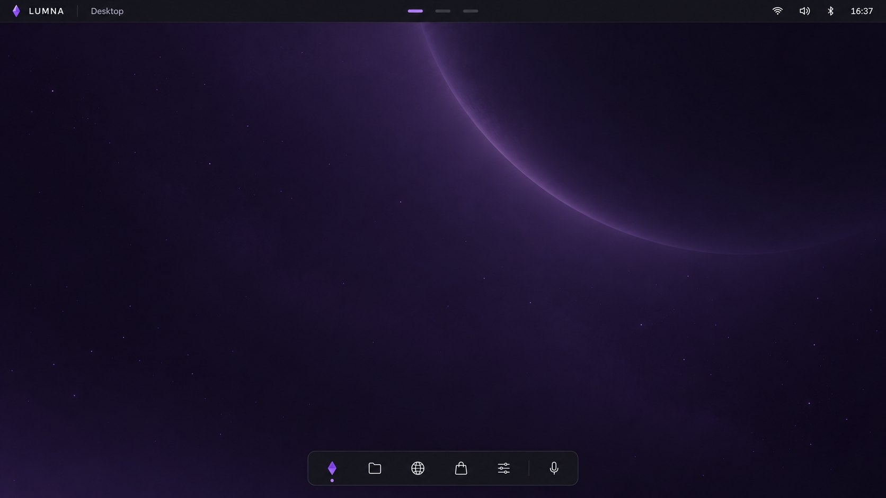
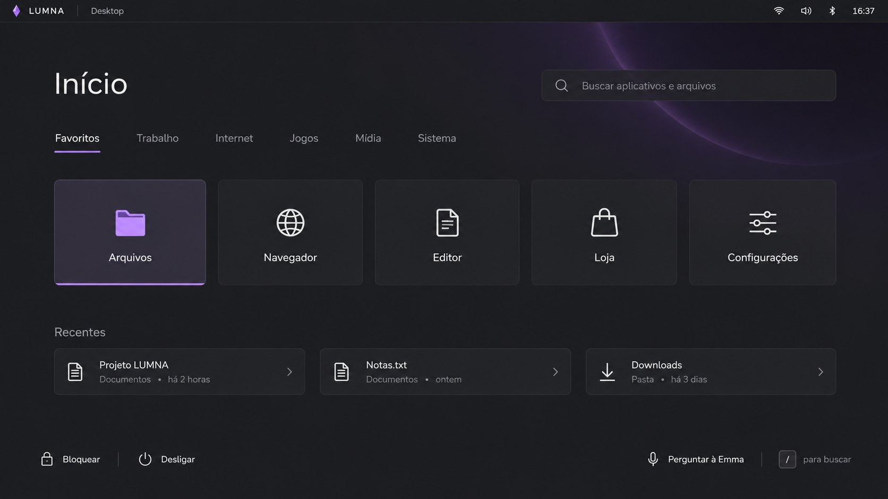
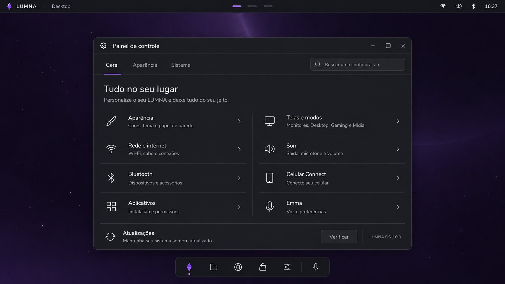
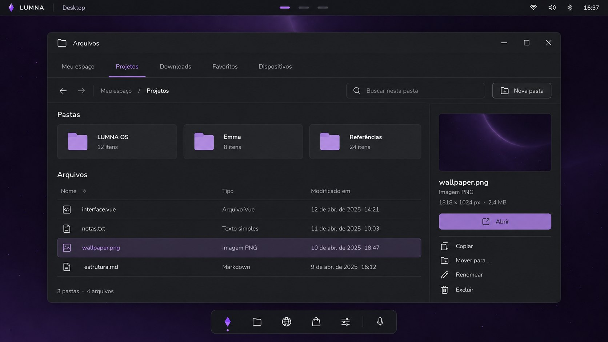

# LUMNA: reestruturação da interface (relatório)

Branch de trabalho: **`lumna-ui`** (saiu da `main` em `4c94258`). A `main` continua recebendo só
consertos; o visual novo cresce aqui e vai para a `main` em pedaços, cada um quando estiver
estável. Referência visual: os mockups em [`docs/visual/`](visual/) e o plano antigo em
[`VISUAL.md`](VISUAL.md), que este relatório atualiza.

| | |
|---|---|
|  |  |
|  |  |

## 1. Onde estamos

O plano do `VISUAL.md` não começou: o shell ainda usa o visual da Fase 0 (vidro violeta,
`--lumna-glass`, bordas roxas, Inter). Nesse meio tempo entrou muita coisa que os mockups não
cobrem ou cobrem só em parte, e que precisa entrar no visual novo também:

| Peça | Hoje | Mockup | Situação |
|---|---|---|---|
| Topbar | cristal, modo, workspaces numerados, bandeja, teclado, rede, som, data/hora, energia | `LUMNA │ Desktop`, tracinhos, ícones, só a hora | redesenhar; manter bandeja, teclado e energia (o mockup não tem, mas fazem falta) |
| Dock | ícones dos apps, configurável, lista de janelas | ícones de traço, Emma no fim | redesenhar; apps de terceiros continuam com o ícone deles |
| Launcher | grade sobre véu | **Início** em tela cheia, abas, Recentes, rodapé | trocar pelo Início |
| Popovers (Áudio, Wi-Fi, Bluetooth, Calendário) | só o menu do Wi-Fi | os quatro | novos (backends já existem, menos calendário) |
| Configurações | barra lateral, 14 páginas | Painel de controle com abas e grade | redesenhar a moldura; as páginas ganham os componentes novos |
| Loja | abas + prateleiras | abas + chips de categoria + cartões | ajuste de estilo, categorias são novas |
| Arquivos | barra lateral + grade/lista | abas de lugares, Pastas em cartões, painel de prévia | maior mudança de janela |
| Barra de título | hyprbars no visual roxo | ícone + título, botões finos | recolorir (hyprland.lua) e o `WindowBar` das janelas do LUMNA |
| Login, bloqueio, descanso, energia | prontos no visual atual | Login | só trocar tokens e wallpaper |
| Mídia, Gaming | Início da Mídia, barra, cortina, biblioteca | — | só trocar tokens |
| Emma, avisos, senha (polkit) | prontos | — | só trocar tokens |
| Celular Connect | pareamento, arquivos, área de transferência, avisos, agendamentos | Celular Connect | funcionalidade pronta; falta a cara do mockup |
| Celular (`--mobile`) | visual próprio (`mobile.css`), já perto dos esboços | — | passar a usar os mesmos tokens |

## 2. Como testar sem estragar a `main`

Duas coisas juntas:

1. **Canal de teste.** O GitHub Actions passa a publicar o branch `lumna-ui` num repositório
   separado, `[lumna-teste]` (release `repo-teste`), com a mesma receita do `[lumna]`. No PC de
   teste, basta trocar o servidor no `pacman.conf` (ou um botão "Versões de teste" na Loja) para
   receber o visual novo pela Loja como hoje; desligando, volta para o `[lumna]` estável.
2. **Chave de visual.** Enquanto a migração não termina, o shell carrega os dois visuais:
   `"ui": "classico" | "novo"` no `settings.json`, aplicado como `data-ui` na raiz de cada janela.
   Cada peça migrada lê os tokens novos só com `data-ui="novo"`. Assim uma peça pronta pode ir
   para a `main` desligada, e quem testa troca e destroca sem reinstalar.

Quando todas as peças estiverem no visual novo e testadas, o novo vira o padrão e o clássico sai.

## 3. A linguagem nova

Os tokens do `VISUAL.md` continuam valendo (medidos dos mockups):

| Token | Valor | Uso |
|---|---|---|
| `--bg-bar` | `#15151d` | topbar e dock |
| `--bg-window` | `#1e1f23` | janelas, popovers, Início |
| `--bg-card` | `#222327` | cartões, linhas, ladrilhos |
| `--bg-input` | `#25262a` | busca, selects, campos |
| `--bg-selected` | `#332f3d` | item selecionado |
| `--line` | `rgba(255,255,255,0.07)` | bordas e divisórias |
| `--accent` | `#8b5cf6` (`#7d46d7` nos toggles) | seleção, botão principal, sliders |
| `--accent-soft` | `#a78bfa` | ícone ativo, texto ativo |
| `--text` / `--muted` | `#ececf1` / `#9a9aa5` | texto e descrições |
| `--ok` / `--danger` | `#22c55e` / `#f87171` | conectado / excluir |

Regras: superfícies grafite e opacas (o roxo só no acento e no wallpaper); raio 14 px nas janelas
e popovers, 10 px nos cartões; ícones de traço; hierarquia por tamanho e peso, quase sem cor; abas
no topo com sublinhado violeta que desliza; popovers surgem da topbar (fade + 6 px, 180 ms).

**Um arquivo de tokens para PC e celular** (`shell/src/ui/tokens.css`): o celular já está perto
desse visual; os dois passam a ler as mesmas variáveis, e o celular só muda tamanhos.

## 4. Como o código fica

Hoje cada tela tem o seu CSS, com cores repetidas (`rgba(14,10,28,…)`, `#1e1f23`, `#8b5cf6`
espalhados em ~40 arquivos). A reestruturação cria um conjunto pequeno de componentes em
`shell/src/ui/`, e as telas passam a montar a partir dele:

`Button`, `IconButton`, `Tabs`, `SearchField`, `Select`, `Slider`, `Toggle`, `Card`, `ListRow`
(ícone + título + descrição + ação), `Tile`, `Section`, `Popover`, `WindowFrame` (barra de título
+ abas + conteúdo), `Empty` (estado vazio).

Ganho além do visual: a próxima mudança de estilo é trocar tokens, não caçar cores em 40 arquivos.

## 5. Etapas

Cada etapa termina com algo que dá para usar, testado no harness e no PC pelo canal de teste.

| # | Etapa | O que entra | Vai para a `main` quando |
|---|---|---|---|
| 0 | **Infra** | branch, canal `[lumna-teste]`, chave de visual, `tokens.css`, fonte | o canal publica e a chave troca o visual de uma tela de exemplo |
| 1 | **Fundação + desktop** | componentes base, topbar, dock, wallpaper do planeta, barra de título (hyprbars + `WindowBar`) | uma semana de uso sem regressão |
| 2 | **Popovers** | Áudio (com medidor do microfone), Wi-Fi (com Outra rede), Bluetooth, Calendário (eventos locais) | todos abrem/fecham pela topbar e pelo teclado |
| 3 | **Início** | substitui o launcher: abas por categoria, Recentes (`recently-used.xbel`), busca de arquivos, rodapé | busca e abertura tão rápidas quanto o launcher de hoje |
| 4 | **Janelas** | Painel de controle (moldura + páginas com os componentes), Loja, Arquivos (abas de lugares, Favoritos, Mover para…) | todas as páginas funcionando como antes |
| 5 | **Telas especiais** | login, bloqueio, descanso, energia, avisos, senha, Emma, Mídia, Gaming nos tokens novos | — |
| 6 | **Celular** | `mobile.css` sobre os tokens | o celular continua igual ou melhor |
| 7 | **Virada** | o visual novo vira o padrão, o clássico sai | tudo acima estável |

Fora desta reestruturação (funcionalidades que os mockups pedem, mas não são visual): rede
editável (IP/DNS/proxy), VPN WireGuard, wallpaper por modo e videopaper.

## 6. Decisões em aberto

1. **Fonte:** Nunito (como nos mockups) ou manter a Inter.
2. **Vidro:** os mockups são opacos. Tirar o blur de vez, ou manter um vidro leve só na topbar e
   no dock.
3. **Início x launcher:** o Início substitui o launcher de vez (o `Super + Espaço` abre o Início),
   ou os dois convivem.
4. **Arquivos:** as abas de lugares substituem a barra lateral de vez (discos e lixeira vão para
   "Dispositivos").
5. **Topbar:** manter a bandeja, o indicador de teclado e o botão de energia (não estão no mockup).
6. **Canal de teste:** publicar o `[lumna-teste]` pelo GitHub Actions (proposto), ou testar só
   pelo ISO de teste.
7. **Editor** no Início: Mousepad, ou um editor próprio mais para frente.
