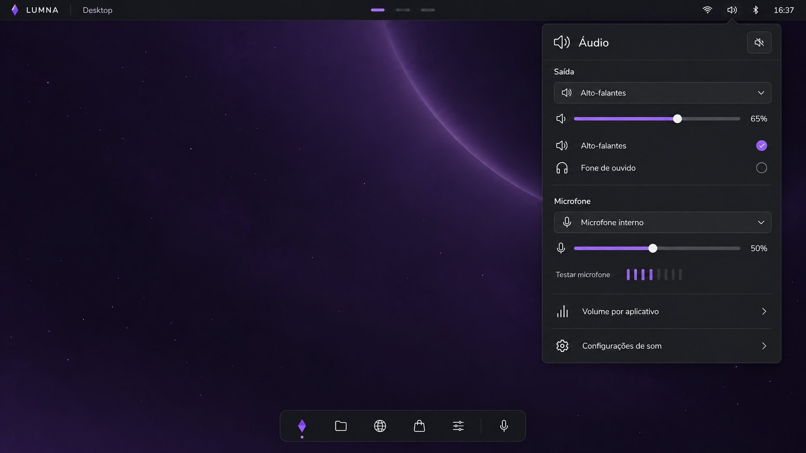
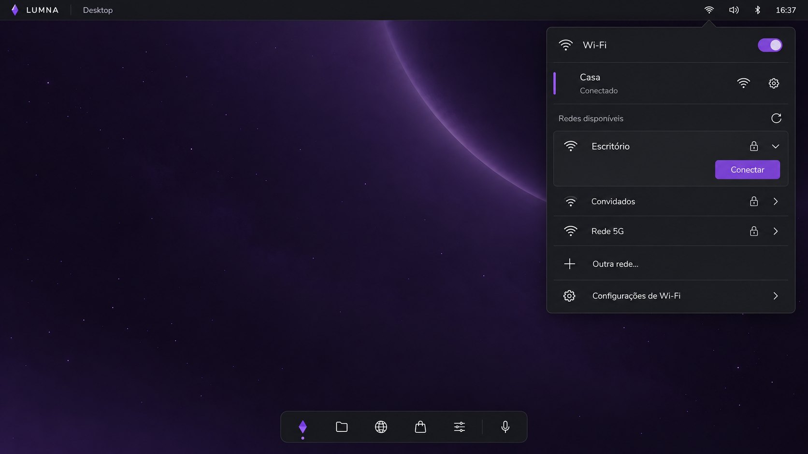
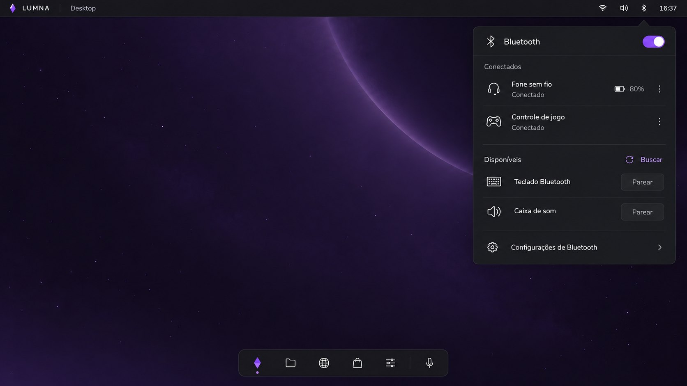
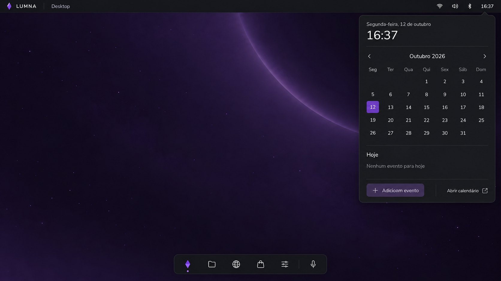
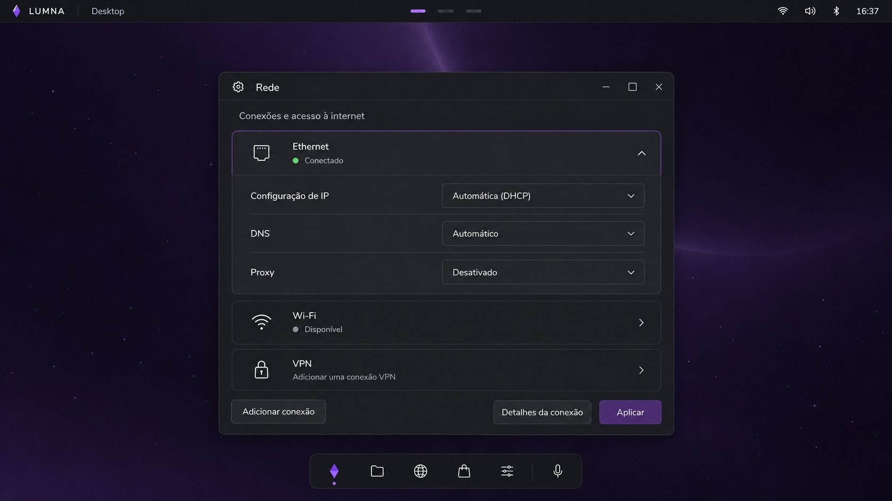
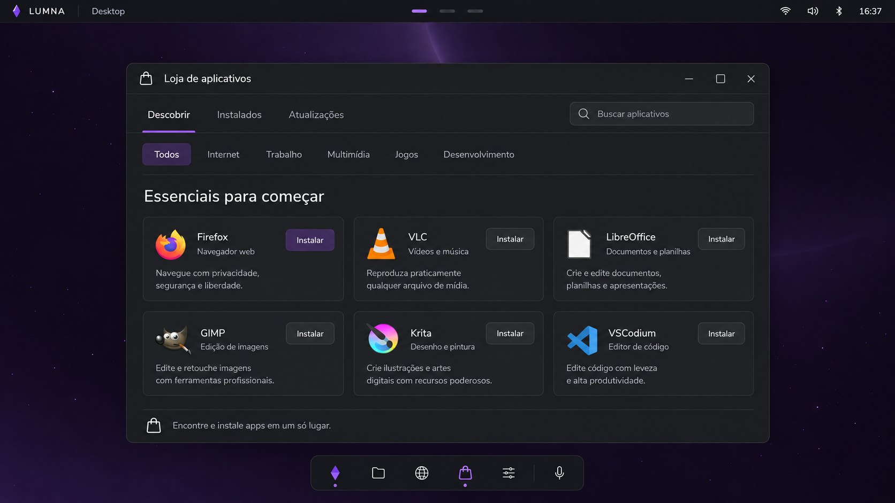
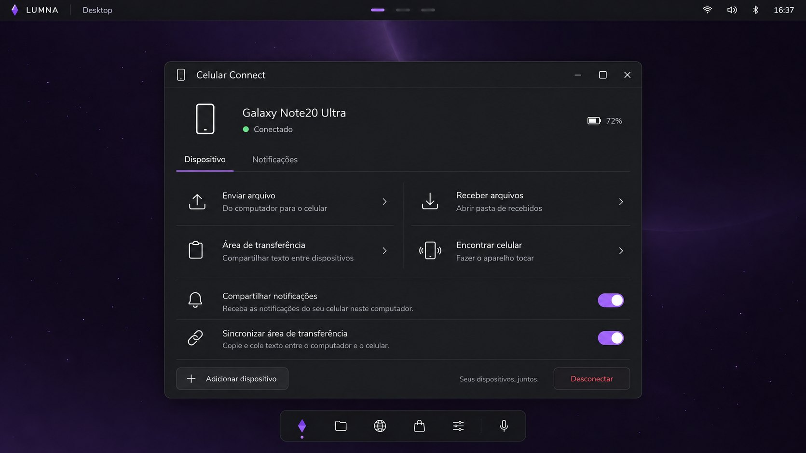
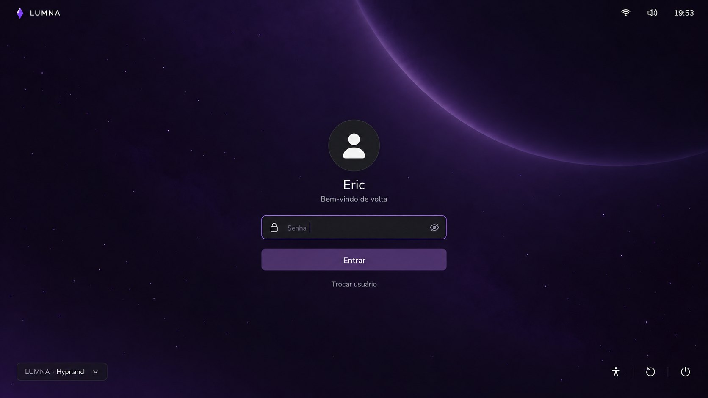

# LUMNA: visual novo (plano)

Referência: os mockups em [`docs/visual/`](visual/). Este documento traduz cada tela em peças
do shell e diz o que é só estilo e o que pede código novo por baixo.

| | |
|---|---|
|  |  |
|  |  |
|  |  |
|  |  |
|  |  |
|  |  |

## 1. A linguagem

O que muda em relação ao visual de hoje:

- **Superfícies grafite, não roxas.** Painéis e janelas em cinza quase preto, opacos, sem o vidro
  violeta. O roxo fica só no **acento** (seleção, botão principal, sliders, toggles) e no
  wallpaper. Isso resolve o degradê "esquisito" da topbar e do seletor.
- **Cantos generosos e bordas finas**: janelas e popovers com raio ~14 px e borda de 1 px um tom
  acima do fundo; cartões internos com raio ~10 px.
- **Ícones de traço** (já é o estilo do `Icon.vue`), com mais respiro e tamanho maior nas listas.
- **Hierarquia por peso e tamanho**, quase sem cor: títulos 26-44 px, rótulos de seção em
  branco suave, descrições em cinza.
- **Abas no topo** em vez de barra lateral nas janelas (Loja, Arquivos, Painel), com o sublinhado
  violeta na aba ativa.

### Tokens (medidos dos mockups)

| Token | Valor | Uso |
|---|---|---|
| `--bg-bar` | `#15151d` | topbar e dock |
| `--bg-window` | `#1e1f23` | janelas, popovers, Início |
| `--bg-card` | `#222327` | cartões, linhas, ladrilhos |
| `--bg-input` | `#25262a` | selects, busca, campos |
| `--bg-selected` | `#332f3d` / `#342c41` | item selecionado (lista, ladrilho) |
| `--line` | `rgba(255,255,255,0.07)` | bordas e divisórias |
| `--accent` | `#8b5cf6` (sólido `#7d46d7` nos toggles) | seleção, botão principal, slider |
| `--accent-soft` | `#a78bfa` | ícone de pasta, texto ativo |
| `--text` | `#ececf1` | texto |
| `--muted` | `#9a9aa5` | descrições, rótulos |
| `--ok` | `#22c55e` | ponto "Conectado" |
| `--danger` | `#f87171` | "Desconectar", excluir |

Fonte: os mockups usam uma sans arredondada (parecida com **Nunito**). Proposta: Nunito para
títulos e interface, mantendo a Inter como reserva; vem no ISO (`ttf-nunito` ou a fonte embutida
no shell).

### Movimento

- Popovers: surgem da borda da topbar (fade + 6 px de deslize, 180 ms, curva `0.22,1,0.36,1`).
- Abas: o sublinhado desliza até a aba nova.
- Ladrilhos e cartões: elevação leve no hover (já existe na Loja).
- Troca de modo: a transição de continuidade (seção 3 da viabilidade) entra nesta fase.

## 2. Peça por peça

| Peça | Mockup | Hoje | O que muda | Código novo por baixo |
|---|---|---|---|---|
| **Wallpaper** | Desktop | gradiente gerado | arte do planeta com estrelas; um por modo (Fase 7) | wallpaper por modo, opcional videopaper (`mpvpaper`) |
| **Topbar** | todos | cristal + modo + workspaces numerados + ícones + data/hora | `LUMNA │ Desktop`; workspaces viram **tracinhos** (o ativo longo e violeta); à direita Wi-Fi, som, **Bluetooth** e só a hora | ícone de Bluetooth com estado |
| **Dock** | Desktop | apps fixos com ícones coloridos | ícones de traço monocromáticos: Início, Arquivos, Navegador, Loja, Configurações, divisória, **Emma** (microfone) | ícones do sistema por id; o botão da Emma (Fase 6) |
| **Início** | Início | launcher em grade sobre véu | tela cheia com título "Início", busca de **apps e arquivos**, abas por categoria, ladrilhos grandes, **Recentes**, rodapé com Bloquear, Desligar, Perguntar à Emma, `/` para buscar | busca de arquivos (índice simples por nome), recentes (`recently-used.xbel`), categorias do `.desktop`, **tela de bloqueio** e menu de energia |
| **Popover Áudio** | Áudio | (só mudo/rolagem no ícone) | saída com seletor + slider, lista de saídas, microfone + slider, **teste de microfone** (medidor), atalhos para volume por app e configurações | medidor de nível do microfone (PipeWire `pw-record`/peak), reaproveita `audio.rs` |
| **Popover Wi-Fi** | Wi-Fi | menu Wi-Fi atual | rede conectada destacada com barra lateral e engrenagem; "Redes disponíveis" com atualizar; **Outra rede…** (rede oculta) | conectar em rede oculta (`Station.ConnectHiddenNetwork`) |
| **Popover Bluetooth** | Bluetooth | só nas Configurações | toggle, Conectados (bateria, menu ⋮), Disponíveis com Buscar e Parear | reaproveita `bluetooth.rs` |
| **Popover Calendário** | Calendário | data na topbar | relógio grande, mês, eventos de hoje, Adicionar evento, Abrir calendário | **eventos locais** (arquivo `.ics` em `~/.local/share/lumna`), depois CalDAV |
| **Painel de controle** | Painel | Configurações com barra lateral | abas Geral/Aparência/Sistema, busca de configuração, grade de categorias, barra de Atualizações com versão | novas páginas: **Aparência** (wallpaper, acento), **Telas e modos** (Fase 5), **Aplicativos** (padrões, permissões), **Celular Connect**, **Emma** |
| **Rede** | Rede | só leitura | Ethernet expansível com **IP manual/DHCP, DNS, proxy**, Wi-Fi, **VPN**, Adicionar conexão, Aplicar | escrever arquivos do systemd-networkd (via `lumna-pkg`-like helper + polkit), proxy do sistema, VPN (WireGuard primeiro) |
| **Loja** | Loja | abas + busca + prateleiras | abas Descobrir/Instalados/Atualizações + busca à direita, **chips de categoria**, "Essenciais para começar" em cartões com descrição | categorias por fonte (AppStream do Flathub, grupos do pacman) |
| **Arquivos** | Arquivos | barra lateral + grade/lista | **abas** Meu espaço/Projetos/Downloads/Favoritos/Dispositivos, seções Pastas (cartões com nº de itens) e Arquivos (tabela), painel com prévia, **Abrir**, Copiar, **Mover para…**, Renomear, Excluir | **Favoritos** (lista salva), contagem de itens por pasta, **Mover para…** (seletor de pasta), dimensões da imagem, tipos mais específicos ("Arquivo Vue", "Imagem PNG") |
| **Tela de login** | Login | tela própria (greetd) já no layout do mockup | falta só o wallpaper novo por trás | sessão escolhida, "Trocar usuário" e acessibilidade já existem |
| **Celular Connect** | Celular Connect | app só de controle remoto | aparelho com bateria; enviar/receber arquivos; área de transferência sincronizada; encontrar celular; notificações do celular no PC | protocolo novo no app Android e no `remote.rs` (arquivos por HTTP na rede local, clipboard, notificações via `NotificationListenerService`, toque) |

## 3. Ordem sugerida

Cada etapa entrega algo usável e não quebra a anterior.

1. **Fundação** (sem funcionalidade nova): tokens no `styles.css`, fonte, `WindowBar` com ícone
   + título à esquerda, componentes base (`Tabs`, `Select`, `Slider`, `Toggle`, `Card`,
   `ListRow`, `Popover`). Topbar, dock e wallpaper novos.
2. **Popovers da topbar**: Áudio, Wi-Fi (com Outra rede), Bluetooth e Calendário (só visual +
   eventos locais). Tudo reaproveita os backends que já existem.
3. **Início**: a tela cheia nova com categorias, Recentes, busca de arquivos e o rodapé
   (Bloquear precisa da tela de bloqueio; Desligar, do menu de energia).
4. **Janelas**: Loja, Arquivos e Painel de controle no layout de abas. Arquivos ganha Favoritos e
   Mover para…; a Loja, categorias.
5. **Rede editável**: IP/DNS/proxy, VPN WireGuard.
6. **Celular Connect**: o app Android cresce de controle remoto para companheiro do PC.
7. **Wallpaper por modo / videopaper** e a transição de continuidade entre modos.

Os passos 1 a 4 mudam o visual inteiro; 5 a 7 são funcionalidades novas que os mockups pedem.

## 4. Decisões em aberto

- **Fonte**: Nunito (como nos mockups) ou manter a Inter.
- **Barra lateral x abas** nos Arquivos: as abas do mockup são lugares; discos e lixeira iriam
  para "Dispositivos" e para o menu. Confirmar se a barra lateral some de vez.
- **"Editor"** no Início: qual app (Mousepad hoje) ou um editor próprio no futuro.
- **Calendário**: só local no começo, ou já sincronizar com Google/CalDAV.
